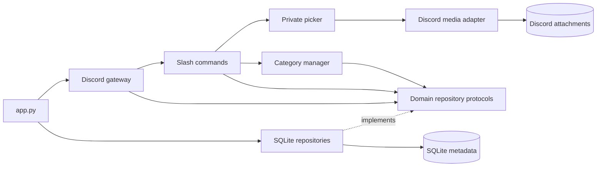

# Architecture

One Python bot serves one Discord server. Original uploads stay in Discord; SQLite stores
metadata and stable source identifiers. All user interaction uses native slash commands,
private previews, selects and buttons.

```text
src/meme_manager/
├── app.py                      # Startup and production dependency wiring
├── config.py                   # Environment validation
├── domain/
│   ├── models.py               # Plain meme input/result records
│   ├── text.py                 # Name normalization and search text rules
│   ├── media.py                # Supported media validation
│   └── repositories.py         # Separate meme/channel storage protocols
├── persistence/
│   ├── database.py             # Connections, transactions and initialization
│   ├── schema.py               # SQLite schema and additive migrations
│   ├── catalog.py              # Meme queries, edits and indexing
│   └── channels.py             # Managed group/channel mappings
└── discord_app/
    ├── bot.py                  # Gateway events and command synchronization
    ├── categories.py           # Create/recover the Memes group and channels
    ├── media.py                # Retrieve and resend original attachments
    ├── picker.py               # Private media preview and result navigation
    └── commands/
        ├── __init__.py         # Assemble the guild's command group
        ├── browse.py           # Search, list and random
        ├── categories.py       # Create categories and import history
        ├── manage.py           # Edit tags/names and remove catalog entries
        └── permissions.py     # Author/server-manager authorization
```

Tests mirror these responsibilities under `tests/domain`, `tests/persistence` and
`tests/discord_app`; `tests/conftest.py` supplies isolated databases and repository wiring.



## Responsibility and dependency rules

- Domain records, validation and protocols import neither Discord nor SQLite.
- `MemeRepository` and `ChannelRepository` are separate, small typed contracts. Gateway and
  category logic receive those contracts; SQLite implementations are selected in `app.py`.
- Repositories contain SQL only. They share a database object that commits successful work,
  rolls back exceptions and closes every owned connection. Schema migration has its own module.
- `MemeBot` owns gateway behavior. `CategoryManager` owns Discord channel lifecycle; `MemeMedia`
  owns attachment retrieval and sending. The picker depends on media operations, not the bot.
- Command registration is grouped by user task. Shared authorization remains in one module.
- Composition replaces application inheritance; only Discord SDK extension points are subclassed.
  There is no DI container, generic base repository, plugin framework or web backend.

## Category lifecycle

On ready, the bot fetches guild channels and restores the group saved in `meme_settings`.
If necessary, it reuses a unique category named **Memes** or creates one and saves its ID.
`/meme category create name:...` normalizes the requested name, checks `meme_channels`, then
reuses or creates a text channel under that group. Separate locks serialize group setup and
channel creation inside the single bot process. Fresh channel lists avoid relying on gateway
cache timing after creation. IDs are saved only after successful Discord operations.

Saved IDs survive Discord renames. Deleted resources are recovered on the next setup/create
call. Ambiguous names and moved children return an error without moving unrelated channels.
Only direct text channels under Memes receive new entries; threads, forums, bot-authored
messages, DMs and other guilds are excluded. Import requires Manage Server.

## Catalog and privacy invariants

- One row per attachment ID; reimport refreshes the channel name and preserves edited titles/tags.
- Display names and normalized `name_index` values are maintained together. Category-filtered
  search/list always retain the configured guild boundary. See [database schema](database-schema.md).
- Original guild/channel/message/attachment IDs identify media. Signed CDN URLs are refreshed
  from Discord and are never persisted in SQLite. No media bytes are stored in the database.
- Deletion events remove the source's indexed rows, even after its channel moves. Offline
  deletions can leave stale records, which show a missing-media warning when accessed.
- Removing an index entry does not delete the original Discord message.

## Preview and sharing

Five results appear per page. Images/GIFs use freshly fetched URLs in the preview embed.
Videos are attached to the private response, within the effective interaction upload limit,
for native Discord playback. Selection changes replace previous attachments. A per-picker
lock serializes rendering so a slow download cannot overwrite a newer selection.
Unavailable/oversized media keeps a source link. Only **Send to channel** shares media publicly.
Playback depends on Discord/client codec support.

## Operational limits

Run one bot process per SQLite database. SQLite operations are small synchronous queries;
revisit event-loop blocking only if measured usage requires it. Discord attachments are not
an archival guarantee: retain backups of important files and the metadata database.
No hashing, OCR, transcoding or semantic search is implemented. Multiple servers would require
a separate product decision and authorization review.
